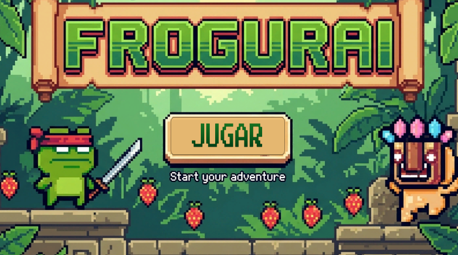
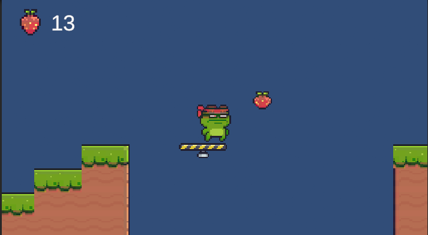
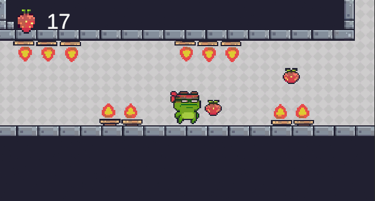
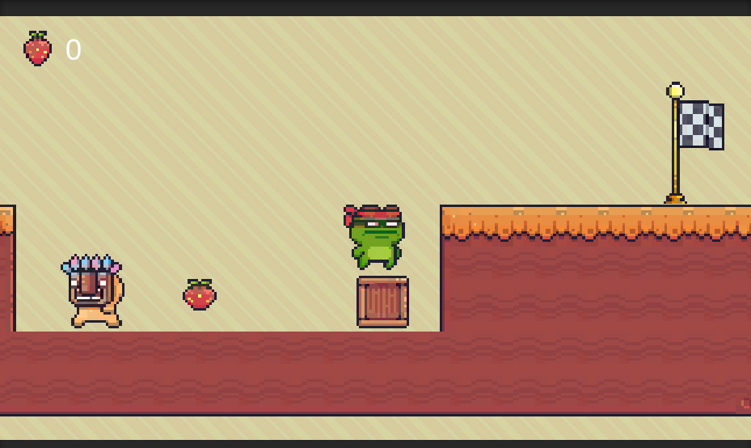
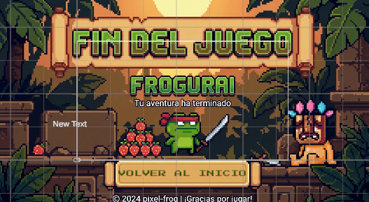

# LopezVazquezPaulaProyecto
#FROGURAI

**Autor:** Paula Vázquez López
**Motor:** Unity (2D)

## De qué va el juego

Es un juego de plataformas 2D en el que controlas a un ninja que debe recorrer varios niveles recogiendo fresas y esquivando peligros. Por el camino hay pinchos, sierras y enemigos que patrullan de un lado a otro. Si tocas un peligro, pierdes una vida y el nivel se reinicia. Puedes derrotar a los enemigos saltando sobre su cabeza. Al llegar a la meta de cada nivel pasas al siguiente, y si te quedas sin vidas, el juego termina.

## Controles

| Acción | Tecla |
|---|---|
| Moverse | A / D o flechas |
| Saltar | Espacio |

## Características
- Movimiento y salto con físicas (Rigidbody2D).
- Animaciones del personaje: parado, correr, saltar, caer y morir.
- Mundo creado con Tilemap y Tile Palette.
- Frutas coleccionables con Prefabs y contador en pantalla.
- Enemigos y trampas con animación de muerte y reinicio del nivel.
- Enemigos y plataformas que se mueven de un lado a otro con un script reutilizable.
- Varios niveles y pantalla de fin con el total de frutas.
- Música de fondo en cada escena y efectos de sonido: salto, pasos y muerte.
- Controles táctiles en pantalla (On-Screen Buttons) para jugar en móvil.
- Exportado para Android (APK).

## Capturas

### Pantalla de inicio

### Nivel 1

### Nivel 2

### Nivel 3

### Pantalla de fin

## Mejoras futuras

- Añadir más niveles.
- Barra de vida visual en lugar de solo el número.
- Doble salto y coleccionables con mejoras temporales.

